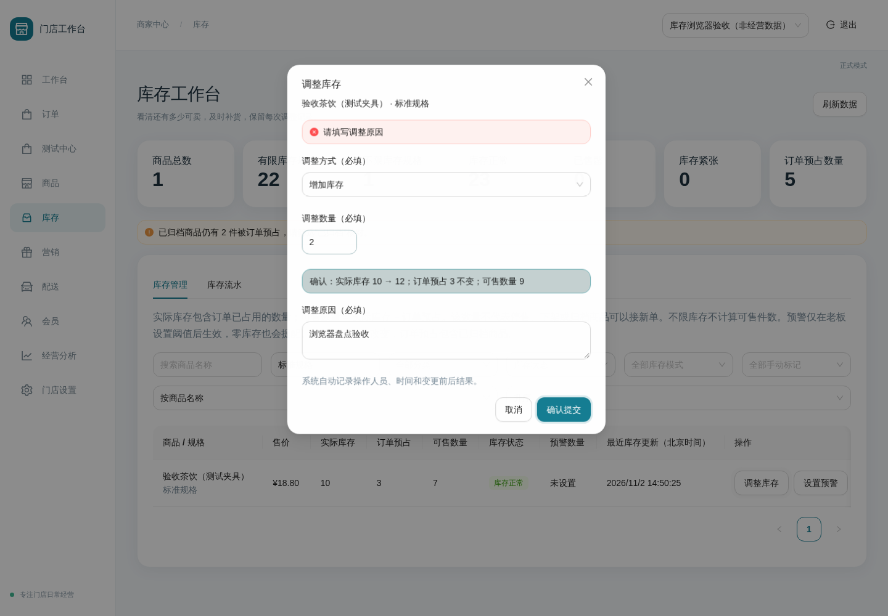
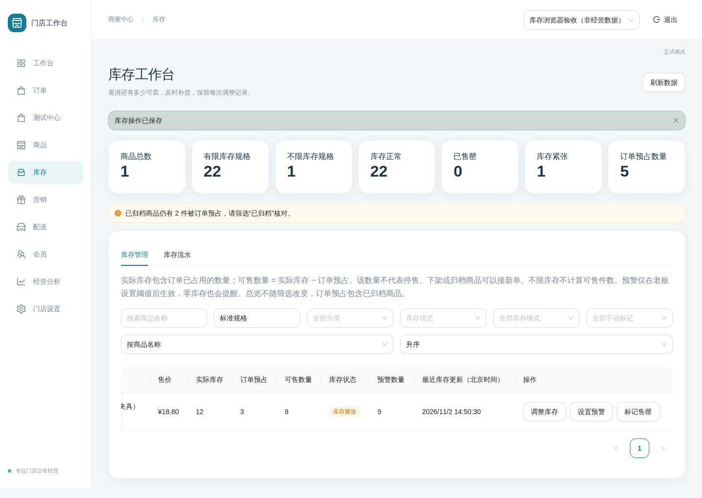
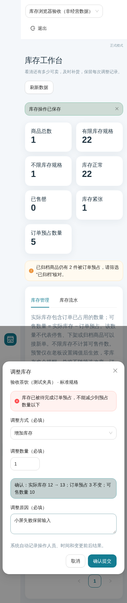
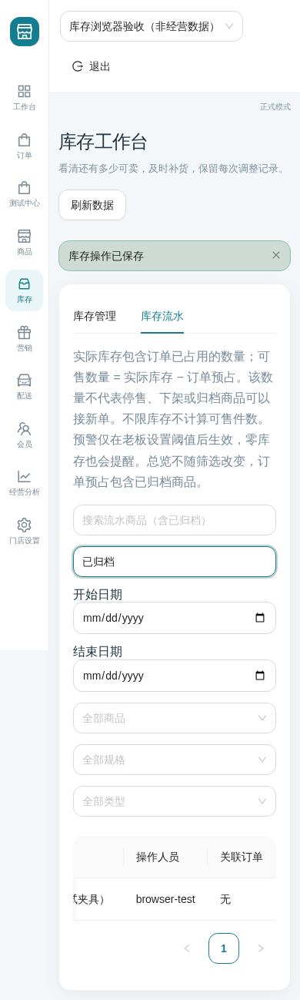

# 商家库存管理工作台

本轮基于 `phase-3-orders-pos-test-center` 的 `61954e9`，保留 C 风格、React/Ant Design、NestJS/Prisma。只提交 `codex/merchant-inventory-console`，不改 #26/#27、不合并、不进入 Phase 4。完整产品缺项见 [产品需求状态表](PRODUCT-REQUIREMENTS-MAP.md)。

## 商家可见行为

入口 `/admin/inventory`。总览读取当前授权门店真实数据库，不使用演示数值；总览不随列表筛选改变。商品总数和有限/不限库存规格数排除归档；订单预占**包括归档规格**，另显示归档占用提示。正常、售罄为主要状态，低库存为独立数量提醒，可能与零库存/手动售罄重叠，卡片不是可相加的互斥分类。

有限规格数量余额 = 实际库存 − 已预占；界面称“可售数量”，同时明确它不代表停售/下架/安全禁售/归档商品允许接新单。不限库存显示“不限库存”，不虚构无限数值。没有可核验历史更新时间显示“暂无记录”，不按迁移时间补写。

可按商品名、规格名、分类、库存状态、库存模式和手动售罄标记独立筛选，按名称/数量/更新时间排序及服务端分页。已归档可单独筛选核对。低库存筛选包含可售数量为零的规格；未设置和 0 不同：null 不提醒，0 在余额为零时提醒。

调整必须填写原因，预览前后数量并明确提交。负库存、低于预占、浮点/整数越界、无限数量调整都拒绝，失败不写流水。弹窗失败保留输入和同一幂等键；同内容重复提交不重复调整，更换内容后生成新键。工作台始终发送键；旧 stock API 的无键调用保持兼容，**无键调用不承诺网络重试去重**。

老板可设置或清空预警。老板/店长可手动售罄及清除标记，必须原因并记录操作者；恢复不增加库存，不绕过下架/安全禁售/归档，余额为零仍不能接新单。普通停售不更改已付款订单原履约规则。

流水按日期（北京时间整日）、商品/规格、类型筛选分页；名称搜索包含已归档商品，不依赖正常目录下拉列表。记录调整/设置前后快照、原因、人员及完成订单关联；新完成扣减记录库存/预占前后数量，原完成扣减算法不变。旧快照未知时保留 null，不倒推历史。商品编辑中的旧售罄/库存模式切换也追加设置流水，自动说明来源；不添加旧接口的原因必填字段以保持兼容。

## API 和权限

所有路径前缀 `/api/v1/admin`，必须 Bearer、`X-Store-Id`。服务端身份和 Merchant→Brand→Store 是权限依据，前端隐藏不代替校验。库存真实管理在 production/TEST_MODE=false 下仍可用，与 Mock 订单开关独立。

| 接口                            | 请求                                                                                                            | 权限                                          |
| ------------------------------- | --------------------------------------------------------------------------------------------------------------- | --------------------------------------------- |
| GET `/inventory`                | page(1)、pageSize(20，最多100)、productSearch、variantSearch、categoryId、state、mode、soldOut、sort、direction | OWNER/MANAGER/COST_MANAGER 读取               |
| GET `/inventory/movements`      | 同分页；productId/variantId、productSearch/variantSearch、type、from/to（带时区时间，起止校验）                 | 三角色读取                                    |
| PATCH `/inventory/variants/:id` | lowStockThreshold（null 或 0–2147483647）、soldOut；至少一项；reason 必填1–500字；idempotencyKey UUID必填       | OWNER 全部；MANAGER 仅售罄；COST_MANAGER 拒绝 |
| POST `/variants/:id/stock`      | delta 非零整数 ±2147483647；reason 必填；idempotencyKey 可选 UUID                                               | OWNER/MANAGER                                 |

state：NORMAL/LOW/EMPTY/PAUSED/INACTIVE/SAFETY/ARCHIVED；mode：finite/unlimited；soldOut：true/false；sort：name/available/updated；direction：asc/desc。所有界面均显示中文映射。type：ADJUSTMENT/ORDER_COMPLETED/SETTINGS。查询严格拒绝额外字段，不允许 body/query 指定租户。列表在 RepeatableRead 读取一致的总览、计数与行；所有用户值绑定 SQL 参数，排序表达式固定。

调整和设置沿用事务及规格行锁；幂等唯一范围为门店+规格+人员+键，指纹区分内容和操作种类。同键不同内容返回409。设置权限先于幂等检查；不直接修改 reservedQuantity，不改订单状态机/预占账本/定价。新接口失败后可保留同内容重试；若请求内容变化应视为新操作并核对库存。

## 数据库与历史

- `202611010001_inventory_console` 已在交接前测试和运行环境执行，本轮不改它：Variant 增加 lowStockThreshold/soldOutReason/inventoryUpdatedAt；InventoryMovement 增加 type/idempotencyKey/requestHash/before/after/orderId、唯一键、时间查询索引、门店订单外键；数据库触发器覆盖订单原始 SQL 对库存/预占的修改。
- 追加 `202611020001_inventory_history_verification`：对旧快照为空的完成分类，再要求同租户已完成且已消耗预占的订单，以及同事务时间、同操作者的不可变 PICKUP/DELIVERED 事件。不能仅凭原因字符串判定完成扣减；不满足的恢复为手工记录且清空订单关联。只校正元数据，不改数量/订单/旧迁移。
- 历史记录展示商品当前名称，订单编号及流水自身原因保留；本轮不提供重命名前商品名称历史快照或原料/生产批次库存。
- 新增数据字段不含成本、利润或 Secret；配置、数据库 URL、GitHub 凭据不进入报告和仓库。测试在独立 `inventory_console_review_test` 数据库，不使用经营库、不执行 down -v。

## 复用与自研理由

复用既有 Ant Design 6.3.3（MIT）Table/Form/Modal/Select/InputNumber/Alert/Tabs/Tag，现有 C 样式、鉴权客户端、门店上下文、精确人民币格式化，以及原 stock 的事务、行锁和边界更新。候选 antd-admin、Ant Design Pro（MIT）只参考既有仓库清单中的筛选/分层表单模式，不复制新第三方源码，不迁移 UI 基座。无新增项目依赖、收费服务或常驻设施。

租户查询、预占保护、幂等及审计数据组合需要匹配本项目既有订单账本，不能直接搬不兼容的电商后端，因此沿用现有领域实现作小范围扩展。详见 [复用记录](OPEN-SOURCE-REUSE.md)。

## 验证记录

最终命令、集成及浏览器记录在提交前据实际结果更新。此前 Windows/飞牛记录不代替本轮最终验证。失败重试必须记录原因，不删除/跳过/弱化旧断言。组件测试与真实浏览器分别记载。

2026-11-02 本轮已执行的专项验证：库存组件 8 项通过；独立数据库集成 24 项通过、无跳过，包含真实订单预占与调整/付款并发、跨门店/品牌/商户夹具、生产角色、设置幂等、整数边界与旧订单回归。全量最终回归仍以提交前记录为准。

真实 Chromium 使用独立 test 数据库和明确标注“非经营数据”的门店，production 配置验证库存接口不依赖 Mock 开关：1440×1000 桌面完成原因必填、前后预览、补货、阈值设置、手动售罄/恢复；390×844 小屏验证保存失败保留原因及已归档流水搜索。小屏首轮发现顶部长期店名撑宽页面，修复顶部换行后整页宽度断言通过，无浏览器脚本异常。失败响应由浏览器拦截注入；正常操作由真实 API/数据库处理。此处测试预占数是夹具，真正订单账本并发由集成测试验证。

## 最终回归（2026-11-03 汇总）

飞牛独立测试环境冻结依赖安装、Prisma generate、format、lint、format:check、typecheck、125 项单元/前端测试、build、连续两次 migrate deploy、24 项 integration 全部通过，无跳过。构建保留既有后台/POS 大包提示。仓库没有 `pnpm db` 脚本，使用仓库规定的 db:generate/db:migrate；未新增含糊别名。

代码提交 `ad182a8`，文档提交 `4326df7`；Draft PR #28 的 checks 与 compose 均通过，运行记录：https://github.com/keileetyranique-commits/dessert-shop-miniapp/actions/runs/41402900983 。运行数据库更新前已在仓库外保存一致性备份；最终运行 smoke 结果以 PR 描述为准。所有功能保持人工待审，不合并。
