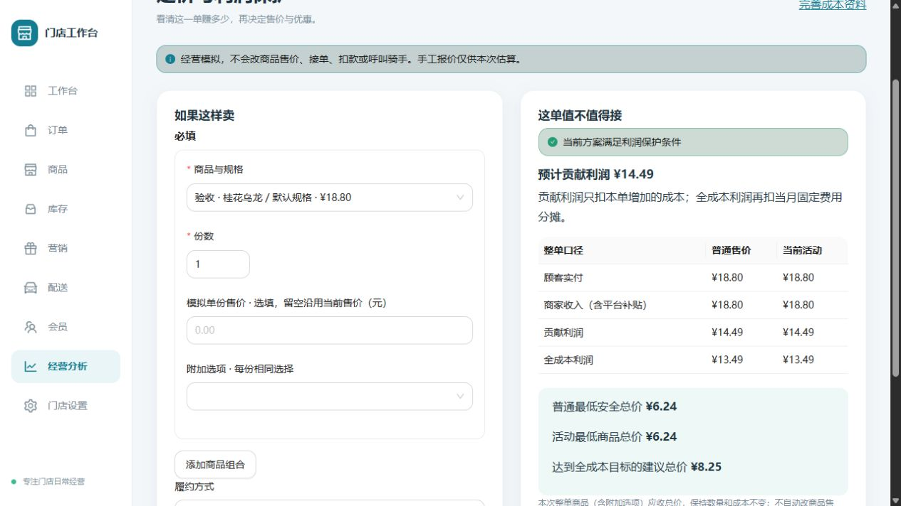

# Phase 2：智能定价与利润保护

基线为 main `477d065`（人工合并的 C 版后台 PR #24），分支 `phase-2-pricing-engine`，对应 Issue #3 的 2026-10-16 执行规格。未合并历史 baseline，未进入 Phase 3。

## 商家使用

运行 `pnpm dev`，访问 http://localhost:5173/admin，以本机环境变量配置的 OWNER 或 COST_MANAGER 凭据登录，选择门店，进入「经营分析」。保持现有 C 版导航和商品页。

1. 老板展开「利润保护与费用规则」，填写整单最低贡献利润、最低利润率、全成本目标、配送距离/负担上限、支付和渠道费用，保存新版本。没有费用必须明确填 0；封顶留空表示无封顶。
2. 若成本未齐全，进入「完善成本资料」，通过既有成本接口补全原料采购、配方、对应履约包装、月固定费用/分摊与可变人工、附加选项成本。没有原料或包装时，必须勾选对应的“确实无需”确认才能保存空清单；没有费用明确保存 0。
3. 选择一个或多个真实商品规格、份数和附加选项；模拟售价留空沿用当前售价。选择自取、堂食或配送。配送输入距离和手工报价，可快速选择 3/5/8 公里。
4. 展开优惠和包装，输入商家券、平台券、百分比优惠、满减、包装收入及整单公共包装（页面每项一个；API 支持数量）。成本月份默认北京时间当前月份。选填优惠/收入留空表示本次明确无此项。
5. 点击计算，对比普通方案与活动方案；资料不齐全时不展示肯定盈利结论。展开依据查看费用、单份成本、配方版本、计算版本与核对编号。

仅模拟，不改商品售价、库存、真实订单、支付或配送。手工报价明确为估算，每次点击计算标记为当前报价、有效五分钟；不是配送商实际承诺。

## 确定性计算口径

所有金额为整数分，比例为整数基点；中间比例、累计和比较使用 BigInt。前端人民币元用已有字符串解析，不使用浮点乘 100。

- 商品应收 = 各规格模拟或当前售价 × 份数 + 各已选附加选项售价 × 份数。
- 商家商品优惠 = 固定券 + 按商品应收计算的百分比优惠 + 达到原应收门槛的满减，最多减至 0。顺序及叠加规则固定，逐项四舍五入到分。
- 商品应收减商家优惠后为商家商品收入；平台券最多抵扣该余额，平台补齐等额收入，不再从商家收入扣一次。
- 顾客实付 = 商品收入 − 平台券 + 包装费收入 + 顾客原配送费 − 商家配送减免。配送减免不得大于顾客原配送费。
- 商家收入 = 顾客实付 + 平台补齐。平台补齐是模拟中的已约定承担额；真实结算不属于本期。
- 支付费基数是顾客实付；渠道佣金基数是商家商品收入（含平台补齐，不含包装与配送收入）。每项费用 = min(封顶, max(最低收费, 基数 × 费率四舍五入 + 固定收费))；没有封顶时不取 min。零基数是否有固定费由显式配置决定。
- 可变成本 = 真实配方原料 + SKU 包装 + 可变人工与其他 + 所选附加选项成本 + 整单公共包装 + 配送商完整报价 + 支付费 + 佣金。
- 贡献利润 = 商家收入 − 可变成本；全成本利润 = 贡献利润 − 月固定费用分摊。不再减一次商家优惠或净配送负担。
- ITEM 使用成本中心的每份固定成本；ORDER 在整单只做一次「月固定费 ÷ 月预计订单数」舍入，避免逐份舍入后乘回的差额。所有商品在一个 RepeatableRead 事务中读取相同资料。
- 每份平均利润使用「整单利润/总份数」分数表示，不在内部过早舍入。利润率显示向零截断，保护门槛用整数交叉相乘精确比较；收入 0 时显示无利润率。

历史设计文档中的“商品实收后再次减商家券”和浮点 JSON 示例不是本期实际接口。以上口径避免重复扣款、重复包装或人工分摊。

## 底价、目标和风险

最低安全价是不使用商品优惠的整单商品应收底线；活动底价应用当前全部商品优惠；建议价同时满足最低贡献保护和目标全成本利润/利润率。都维持份数、附加选项和成本不变，输出整单商品总价，不把一个价格覆盖所有规格。配送/包装收入和费用使用当前场景。

底价不是简单相减，也不是假设利润单调的二分搜索。先按满减门槛分段；各段内收入、费用分别单调，用区间收入上界和费用下界排除不可能区间，再从左向右精确查找。支持两个独立手续费的舍入台阶、最小收费和封顶。搜索范围 0–2147483647 分；每个价格最多访问 20000 个区间，超限明确提示人工核验，不输出未经证明的底价。返回 null 可表示资料缺失、范围内无可行价或搜索未完成，结合 missingInputs/warnings 解释。

PASS：资料齐全、可售/库存及距离允许、利润和利润率达标、商家净配送负担未超限。

TOPUP：配送场景可在顾客尚未承担的完整配送报价以内补差，逐分重算手续费和门槛，返回最小有效补差额。API 配送报价上限 100000 分，避免无界搜索。顾客补足完整运费仍不达标则 REJECT。补差不能绕过库存、停售、硬配送距离或缺失资料。

MANUAL_REVIEW：成本 PARTIAL、选项成本 null、保护规则未保存、报价缺失/过期/时间无效。零成本与未配置完全不同。完整报价最长十五分钟；无真实配送接入时不宣称实际可履约。

REJECT：明确不可售、库存不足、门店停用、超配送范围或当前方案无法在规则内补足。归档/跨店对象直接拒绝请求。结果只供商家判断，不构成真实订单授权。

## API 与权限

统一前缀 `/api/v1/admin`，Bearer 和 X-Store-Id，沿用 Merchant → Brand → Store。

| 接口                         | 用途                                     | 权限                 |
| ---------------------------- | ---------------------------------------- | -------------------- |
| GET /pricing/rules           | 当前门店最新保护规则；未设置返回 null    | OWNER / COST_MANAGER |
| PUT /pricing/rules           | 新增规则版本，保留历史；模拟不能覆盖规则 | OWNER                |
| POST /pricing/simulate       | 读取真实成本、精确计算并保存本次依据     | OWNER / COST_MANAGER |
| GET /pricing/simulations/:id | 本店不可变模拟历史                       | OWNER / COST_MANAGER |

请求字段和范围以 `pricing.validation.ts` 为准，严格拒绝额外字段、浮点钱数及越界数值；客户端不能提交成本或绕过持久化规则。MANAGER 不获得利润及成本接口权限。历史接口不提供更新/删除；模拟不创建 CostSnapshot，不改旧成本快照。

每个模拟记录包含完整输入、真实规格/选项、配方与采购来源、成本计算版本、规则版本、计算时间、配送报价时间、费用归属及计算结果；后续采购或规则变更不会覆盖它。计算无需 AI。

## 数据库与迁移

- `202610160001_pricing_engine`：增加 pricing_rules、pricing_simulations，两者均有商户/品牌/门店复合外键、查询索引及操作者。
- `202610160002_pricing_rule_order`：为规则增加单调递增 revision，避免同毫秒写入通过随机 UUID 排序而错误读取旧规则。首个新迁移已在隔离测试库执行，所以用追加迁移修正，未改已执行迁移。
- 原 CostController 的一致读取抽为 cost-reader，旧只读预览与显式快照接口保持行为。

## 验收

运行冻结锁文件安装、db:generate、lint、format:check、typecheck、test、build、两次 db:migrate、test:integration，以及 Compose 启动和 smoke。测试覆盖三种距离、券归属、满减断点、附加选项、订单包装、ORDER 舍入、零金额、费用边界/封顶/舍入、非法输入和上溢、缺失/过期报价、缺成本、库存/归档、生产角色与租户隔离、历史依据不变。底价另与小范围逐分穷举对照。

前端回归验证只读权限、中文错误、真实规格、元转分请求、缺失资料不显示盈利、不会写商品价格。所有 Phase 0/1 回归同时运行。实际结果与 CI 在 Draft PR 中记录。

本地验收：89 项单元/前端测试、16 项数据库集成测试通过，两次部署迁移通过，Compose 启动和鉴权 smoke 通过。浏览器验证首次不展开选填区域即可计算、缺成本禁止盈利判断、老板保存规则、C 版成本补录和重新计算。使用本地“验收 · 桂花乌龙”演示数据（不是实际经营数据）：售价 18.80 元、可变成本 4.20 元、固定分摊 1 元、支付费率 0.6%，得到贡献利润 14.49 元、全成本利润 13.49 元、安全总价 6.24 元、建议总价 8.25 元。

## 复用及边界

PR #25 人工审查修复：空配方请求增加 `noIngredientsConfirmed`，空商品包装请求增加 `noPackagingConfirmed`（均必须是布尔 true）；前后端同时校验，未确认不会写入或清空旧资料。表单确认默认未勾选，修改任何成本字段、规格、履约方式或清单，以及保存成功后均重置。非空清单按原流程保存。定价页仅列出启用选项组中的启用选项，服务端继续校验归属、状态与数量限制。复用现有 Ant Design Checkbox/Form，无新依赖、无迁移、无权限变化；历史已保存的空清单和快照不被重新分类或覆盖。

复用既有 C 外壳、Ant Design（MIT）、鉴权/请求和人民币转换、成本中心数据库及算法；没有新增第三方依赖。利润保护是项目规则要求的差异化能力，按本项目成本/租户约束自研，未引入新的 UI 基座。

不做真实订单、支付、配送、自动改价、AI、Phase 3 或固定费用混合分摊。本期成本补录入口复用既有接口，尚不是采购/配方历史的完整管理界面。模拟历史不自动清理，正式大规模使用前需制定保留与归档策略。

构建通过，但后台主包仍有超过 500 kB 的体积提示，后续可按页面拆包优化首屏加载；本轮不重构现有打包体系。
