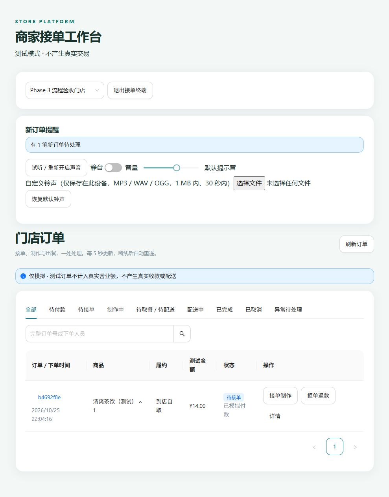
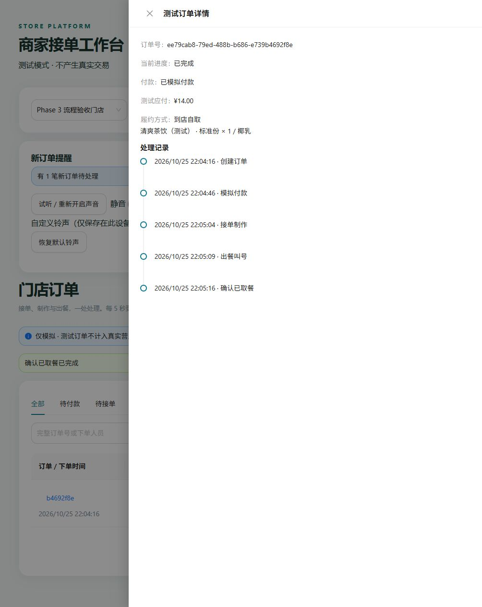
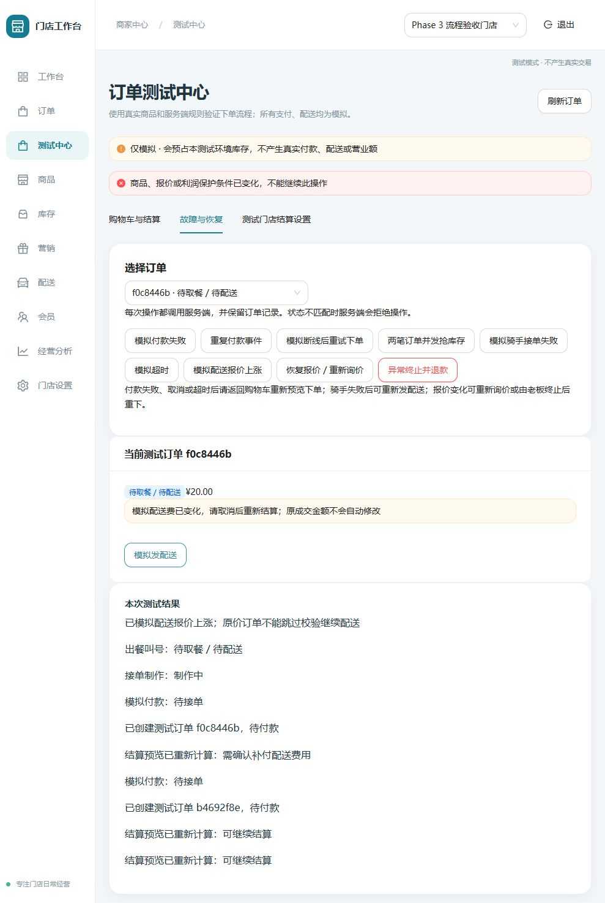
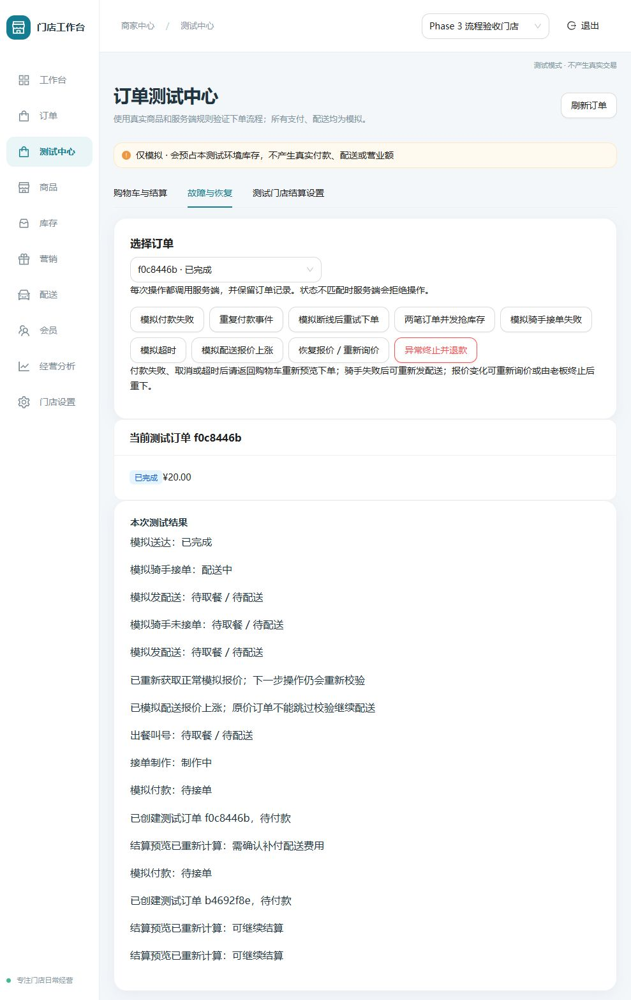
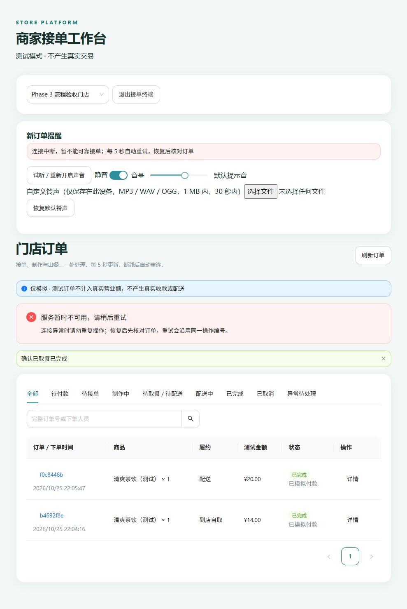
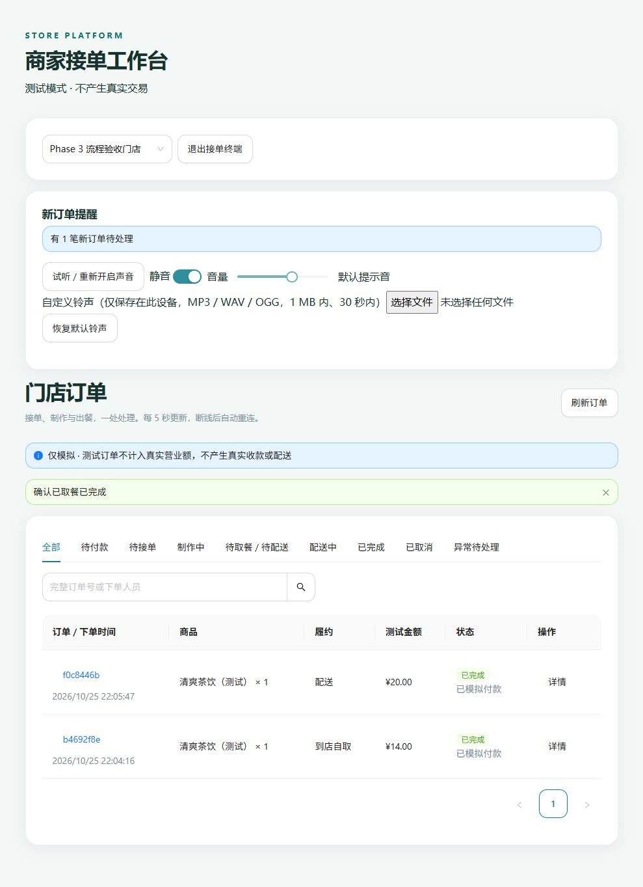
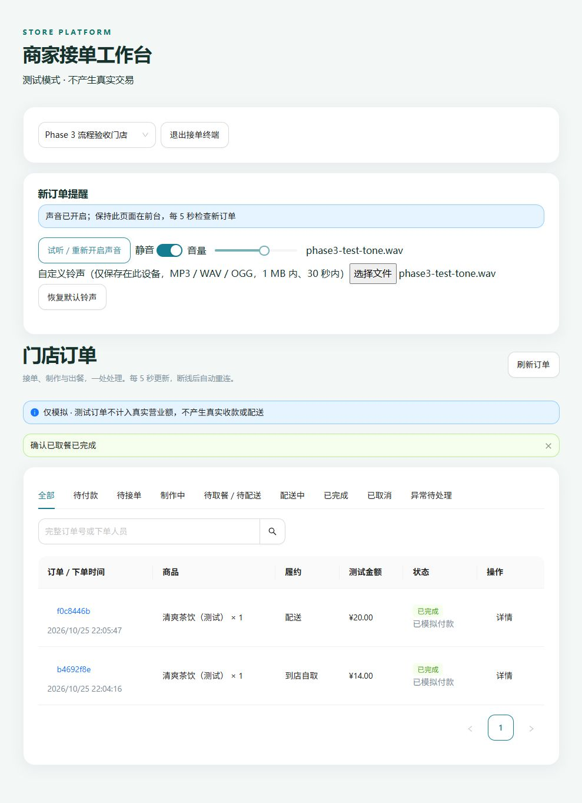

# Phase 3 实际验收记录

日期：2026-10-25。本地 Docker 开发环境、PostgreSQL 16、Redis 7、内嵌浏览器。仅使用“Phase 3 流程验收门店”，无真实交易。

## 真实浏览器操作

1. 后台和 POS 独立登录、选择同店。清爽茶饮 ¥12.00 加椰乳 ¥2.00，数量 1，购物车自取结算 ¥14.00。
2. 提交订单 `ee79cab8-79ed-488b-b686-e739b4692f8e`，模拟付款。POS 自动显示一笔新订单，实际点击开启声音、接单制作、出餐叫号、确认取餐；详情显示完整服务端事件和已完成。
3. 相同购物车改为 3 公里配送，要求补差 ¥6.00，未同意时提交禁用。明确同意后创建尾号 `f0c8446b` 的订单，应付 ¥20.00；模拟付款、接单、出餐。
4. 模拟报价上涨后发配送，服务端拒绝并显示中文原因；恢复报价、发配送、模拟骑手接单失败，显示可重试；再次发配送、骑手接单、模拟送达，订单完成，金额仍为 ¥20.00。
5. POS 开启静音。实际停止 API 容器，显示连接中断和请勿重复操作；重启 API，POS 自动重连，两个订单及完成状态仍在，无需重新登录。
6. 上传本地生成的 1 秒 WAV 音频，页面确认铃声保存，点击试听成功，再恢复默认铃声。这验证了解码和播放调用，不替代用户确认扬声器音量。

## 实际截图

## 自动化覆盖

单元/前端覆盖状态机、乱序付款、终态、恢复取消、白名单、订单数据显示/错误、结算请求、补差确认和展示、POS 用户激活/去重/静音/断线恢复/音频资源释放。

数据库集成覆盖自取、堂食、3/5/8 公里、并发库存、回滚、同键重试、不可变快照、报价失效/上涨/恢复、骑手失败重试、重复完成、老板退款、组合商品/选项/整单包装/满减/双方优惠券、缺成本阻断、显式补差。逐接口检查生产、关闭测试模式、成本角色拒绝及租户隔离。

执行完整 lint、format:check、typecheck、test、build，两次迁移、17 项 integration、Compose 健康与 smoke。原 Phase 0/1/2 测试继续执行。远程 CI 结果以 PR 最新记录为准。

堂食、5/8 公里、组合和并发通过数据库集成测试验证；上面的自取/3 公里配送与恢复则实际在浏览器操作，不把自动化测试冒充手动验收。
